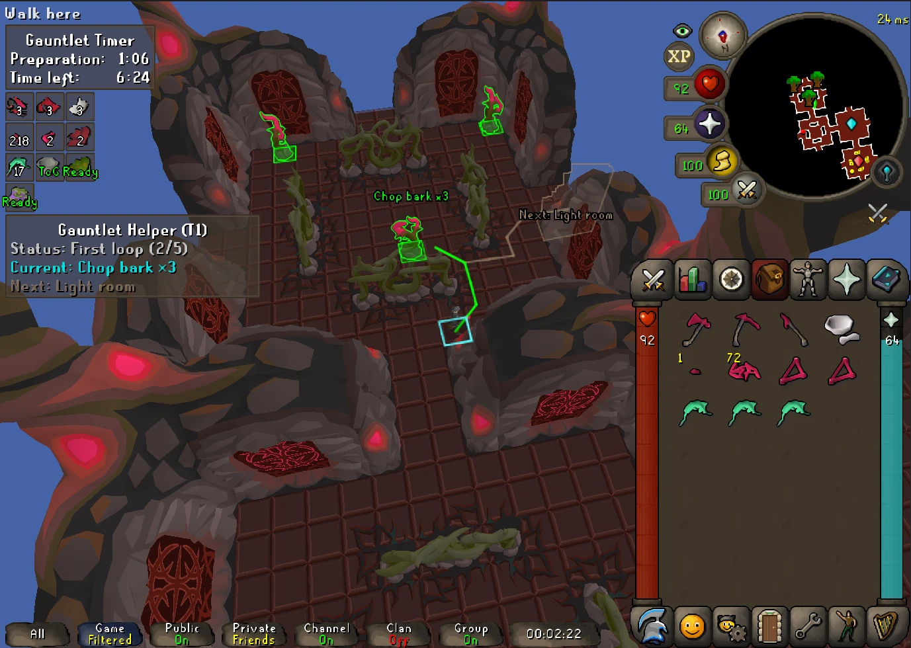
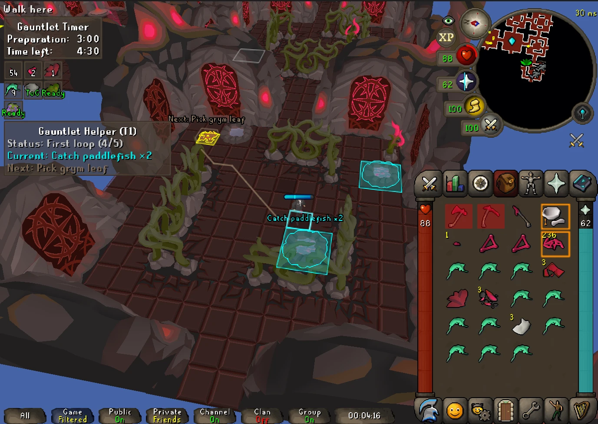
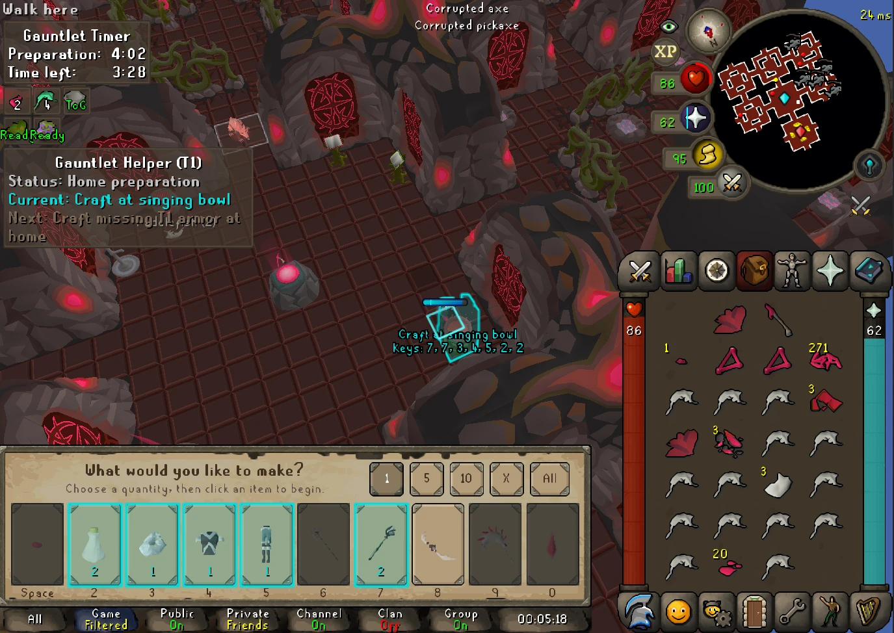
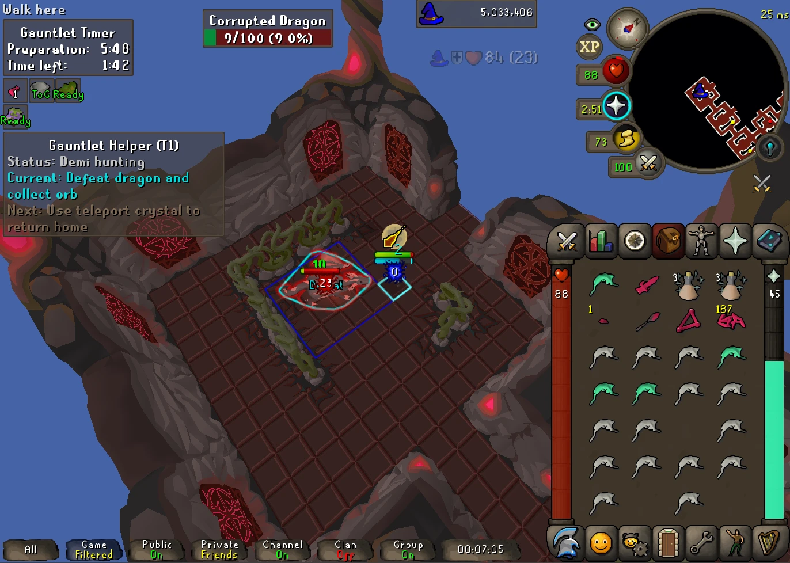

# Gauntlet Helper

A [RuneLite](https://runelite.net) plugin that guides the preparation phase of a **Corrupted Gauntlet** or **regular
Gauntlet** run (no armor or full T1, T2 or T3 armor), in the style of Quest Helper: it shows what to do now, what comes next, and where to go, while you do every click yourself.

## What it does

The plugin follows one preparation plan: full T1 armor (or none, T2 or T3 with the Armor goal setting), a perfected staff plus a perfected
bow or halberd, 20 cooked paddlefish and two potions (one per Grym leaf, none with 0). Along the way it:

- **Plans the five-room opening.** It starts with the nearer of the two side rooms (to one side of the line towards
  Hunllef, never the room straight opposite) and walks the U-shaped circle of five rooms around the starting room,
  gathering what each room offers before lighting the next door.
- **Highlights the current task and previews the next one.** The current task (teal by default) gets an outline,
  a short caption such as *Light room* or *Defeat*, and a walking path. The next task gets a faint outline
  and a thin path from where the current one ends. A panel line shows the current phase: first loop, home
  preparation, demi hunting, finishing resources, returning home, final preparation, ready.
- **Orders resources within a room.** Ore, bark, linum tirinum, Grym leaves and fishing spots are toured in an order that also
  accounts for the room's exit, and only as many nodes as the remaining requirement needs. Resource nodes are
  outlined by type and stop being colored once you have enough.
- **Picks kill objectives.** Rats, bats and spiders become *Defeat* objectives when you still need shards or weapon
  frames. Larger mobs only become objectives late, when much of the shard total is still missing. All six ordinary
  enemy types keep a gray tile marker.
- **Guides home visits.** At the starting room it marks the singing bowl's recipes: teal to craft now, yellow for
  wanted but not makeable yet, dimmed gray for not needed. Crafts follow a fixed order: basic staff, attuned staff, T1 armor, upgraded weapons, then vials (and the armor upgrades last, with the T2 or T3 goal). Filling vials, cooking at the range and leaving surplus fish
  on the floor follow. Inventory items to drop get red squares; items to equip, fill, mix or grind get colored
  outlines.
- **Hunts the demi-bosses.** After the first home visit it heads outward and searches the perimeter rooms for the
  demi-bosses whose drops you still need. A living demi you need gets a clickbox and a *Defeat* caption, and the
  guide waits in that room until the drop is picked up. The hunt ends when you hold the upgrades, not after a fixed
  number of kills.
- **Handles food last.** Fish left at home only becomes a pickup once gear, potions and the fish total are done.
  The prep timer drives return-home advice (90 seconds left by default).
- **Guards entry with raw fish.** While you hold raw paddlefish, Pass and Quick-pass on Hunllef's barrier move below
  Walk here, so a left click doesn't take you in with uncooked food; right-click to enter anyway.
- **Reorders ground-item menus.** With **Reorder ground items** on, the Take of an item with a teal name moves above
  the other Takes on a tile. Entries are only reordered, never removed.
- **Can hide the game's Time Left box.** **Hide the game's Time Left box** (off by default) hides it so the Timers overlay
  shows the time once; it comes back when the setting is off or you leave.
- **Works in both Gauntlets.** The regular Gauntlet gets the same guidance and the same goal settings (a lower
  Paddlefish target is usually enough there), its 10:00 of prep time, and the inner ring searched first for
  materials as well as fish, since the regular ring holds a guaranteed room for each.
- **Optional Hunllef tiles.** During the boss fight it can color Hunllef's tile by the protection prayer Hunllef has
  active (red melee, green ranged, blue magic) and outline tornado tiles. These visuals are adapted from The
  Gauntlet plugin (see Credits). It can also mark a fixed set of tiles in Hunllef's room (off by default), the same
  tiles as the Tile Packs plugin's Hunllef pack, and redraw Hunllef's prayer-disable orb as another boss's projectile,
  as the Hunllef Projectiles plugin does.

## Conflicts with other plugins

Gauntlet Helper is meant to be the one plugin you need for a Gauntlet run, so it has its own versions of the highlights these plugins draw, some adapted from them (see Credits). To avoid drawing them twice, it declares a conflict with The Gauntlet, Gauntlet Minimap, Gauntlet Crafting and Hunllef Projectiles from the Plugin Hub: enabling one switches the other off.

## Main settings

Only the first section, Setup (the weapon pair, the armor goal and how much food and potion to prepare, in either
Gauntlet), opens by default. Everything else works as it is.

Colors, tracker displays (overlay, infobox, both or hidden), resource outlines and minimap markers are all
configurable. Every setting and its default is listed in [docs/product/SETTINGS.md](docs/product/SETTINGS.md).

## Limits

- **Goals are settings.** The Armor goal, Paddlefish and Grym leaf settings decide the loadout; the plugin never changes them on its own.
- **Everything is manual.** The plugin only observes the game and draws highlights.
- **No combat prediction or advice.** There is no attack prediction, prayer-switch advice or safe-spot routing. The
  Hunllef and tornado tiles show their current state only, and the room tile markers never react to the fight.
- **Plans are estimates.** Unseen rooms, node yields and drops are unknown until observed, and route planning is
  bounded, so the suggested route is a good one, not a proven fastest run. Paths use collision data and ignore NPCs.
- **Enabling mid-run** rebuilds what you hold, but not earlier kills or ground items it never saw.

## Privacy

The plugin sends nothing anywhere. The **Log attempts** setting (off by default) writes each attempt to
`~/.runelite/plugin-data/gauntlet-helper/attempts` on your own computer, one line per game tick with what changed: your position,
inventory, the scene and the guidance shown. It is meant for attaching to bug reports. The newest 50 recordings are kept (setting **Keep recordings**;
0 keeps them all).

## Contributing

Bug reports and pull requests are welcome. Not every in-game situation has been seen yet. For a guidance bug, a
recording of the attempt (Log attempts on) makes it much easier to reproduce: it shows exactly what the plugin saw and
said at every tick.

[CONTRIBUTING.md](CONTRIBUTING.md) covers a map of the code, the rules a change has to respect and how pull requests are handled.

## License and credits

BSD 2-Clause; see [LICENSE](LICENSE).

The Hunllef prayer tile, the tornado tile renderer and the resource node outlines are adapted from
[The Gauntlet](https://github.com/LlemonDuck/the-gauntlet) plugin by rdutta, under its BSD 2-Clause license. Its copyright
notice is reproduced in [THIRD_PARTY_NOTICES.md](THIRD_PARTY_NOTICES.md), along with credit to Quest Helper, Gauntlet
Crafting and the other projects that inspired this one.

The prayer-disable projectile swap is adapted from [Hunllef Projectiles](https://github.com/neonsulfur/hunllef-projectiles)
by neonsulfur, itself built on InfernoStats' [Vardorvis Projectiles](https://github.com/InfernoStats/vardorvis-projectiles),
under its BSD 2-Clause license; that notice is in THIRD_PARTY_NOTICES.md too.

Not affiliated with Jagex or RuneLite.
