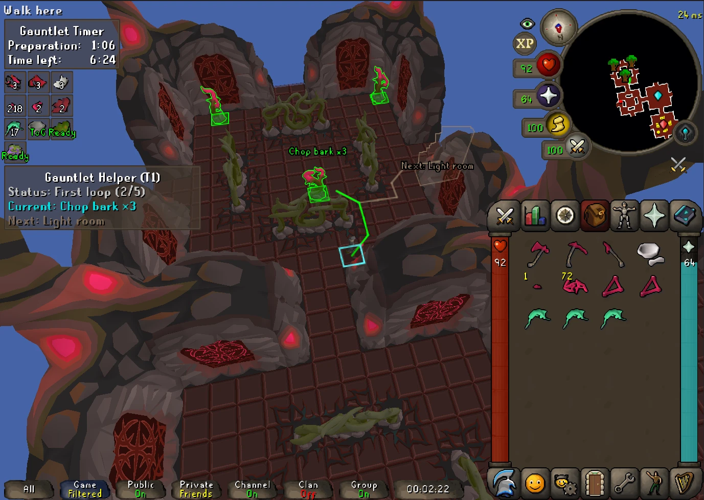
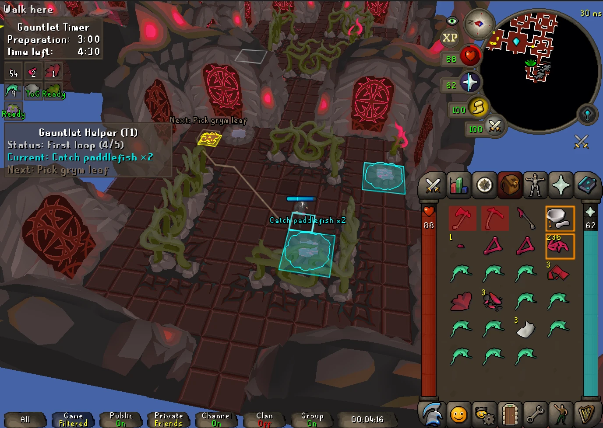
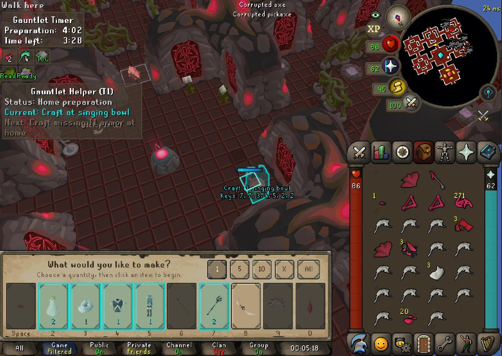
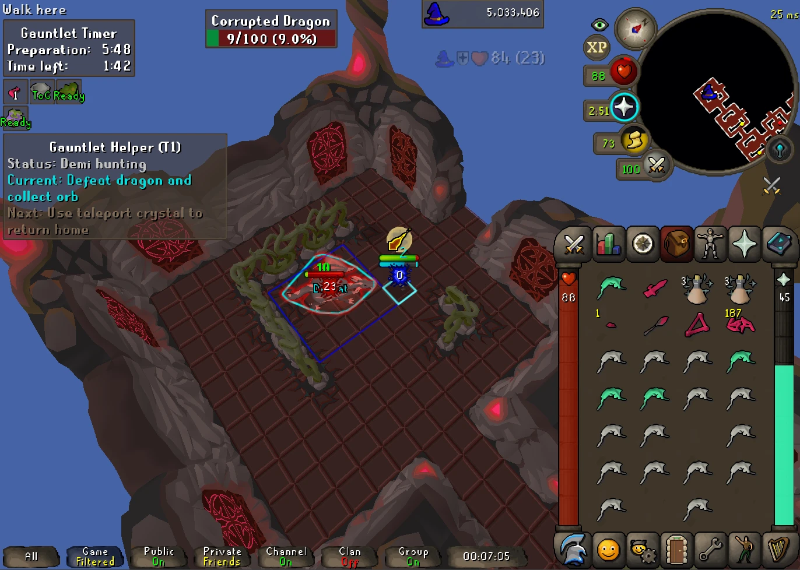

# Gauntlet Helper

A [RuneLite](https://runelite.net) plugin that works like Quest Helper for Gauntlet prep, in both the **Corrupted** and
**regular Gauntlet**.

## What it does

Full Gauntlet prep guidance for resources, weapons, armor, food and potions, all configurable in Setup.

- **Current and next tasks.** The current task is highlighted with a path to it, and the next one is previewed.
- **Starting 5-room loop.** Guides you around the five rooms next to the starting room.
- **Resource pathing.** Paths between the resources you still need in each room.
- **Kill targets.** Marks the enemy to kill when you need shards or weapon frames.
- **Crafting at home.** Highlights the singing bowl recipes to craft and the items to fill, cook, equip or drop.
- **Demi-boss guidance.** After your first trip home, it points you toward the demis whose drops you still need,
  labels doors into the guaranteed demi rooms and marks the demi to fight.
- **Low prep time warning.** When the prep timer runs low (90 seconds left by default, set by **Return warning
  seconds**), it tells you to head home.
- **Blocks entering Hunllef with raw fish.** While you hold raw paddlefish, a left click on Hunllef's barrier walks
  instead of entering. Right-click to enter anyway.
- **Reorders ground item pickup by needed items.** On a tile with several items, a left click takes the one you need
  first (**Reorder ground items**). Nothing is removed from the menu.
- **Works in both Gauntlets.** The regular Gauntlet gets the same guidance and settings.
- **Hunllef fight extras.** Hunllef's tile is colored by the prayer it's protecting with (red melee, green ranged,
  blue magic) and tornado tiles are outlined, as in The Gauntlet plugin. Optional: tile markers in Hunllef's room
  (the Tile Packs plugin's Hunllef pack), Hunllef's prayer-disable orb redrawn as another boss's projectile (as in
  Hunllef Projectiles) and hiding the game's Time Left box.

## Conflicts with other plugins

Gauntlet Helper already draws what these Plugin Hub plugins do, so it can't run alongside them: The Gauntlet,
Gauntlet Minimap, Gauntlet Crafting, Hunllef Projectiles and Gauntlet Map. Turning one on turns the other off. (Its
own room map, like Gauntlet Map's, is off until you turn on **Map overlay**.)

## Main settings

Setup is the section to look at: your weapon pair, armor goal, and how much food and how many potions to make.
Everything else works out of the box. Colors, displays, outlines and minimap markers can all be changed; every
setting is listed in [docs/product/SETTINGS.md](docs/product/SETTINGS.md).

## Limits

- **No fight advice.** It doesn't predict Hunllef's attacks or tell you when to switch prayers or where to stand. The
  Hunllef and tornado tiles only show what's happening right now.
- **Routes are general advice, not perfect.** It can't know what's in a room until you light it, how much a resource
  gives or what an enemy drops, so it plans from what it has seen.

## Privacy

Nothing is recorded unless you turn on **Log attempts** (off by default). Recordings are saved only on your computer,
in `~/.runelite/plugin-data/gauntlet-helper/attempts`, for attaching to bug reports, and the newest 50 are kept
(**Keep recordings**; 0 keeps all). The plugin makes no network connections.

## Contributing

Bug reports and pull requests are welcome; not every in-game situation has been seen yet. For a guidance bug,
attach a recording of the attempt (Log attempts on): it shows exactly what the plugin saw and said.

[CONTRIBUTING.md](CONTRIBUTING.md) covers a map of the code, the rules a change has to respect and how pull requests are handled.

## License and credits

BSD 2-Clause; see [LICENSE](LICENSE).

The Hunllef prayer tile, the tornado tile renderer and the resource node outlines are adapted from
[The Gauntlet](https://github.com/LlemonDuck/the-gauntlet) plugin by rdutta, under its BSD 2-Clause license. Its copyright
notice is reproduced in [THIRD_PARTY_NOTICES.md](THIRD_PARTY_NOTICES.md), along with credit to Quest Helper, Gauntlet
Crafting and the other projects that inspired this one.

The prayer-disable projectile swap is adapted from [Hunllef Projectiles](https://github.com/neonsulfur/hunllef-projectiles)
by neonsulfur, itself built on InfernoStats' [Vardorvis Projectiles](https://github.com/InfernoStats/vardorvis-projectiles),
under its BSD 2-Clause license; that notice is in THIRD_PARTY_NOTICES.md too.

Not affiliated with Jagex or RuneLite.
